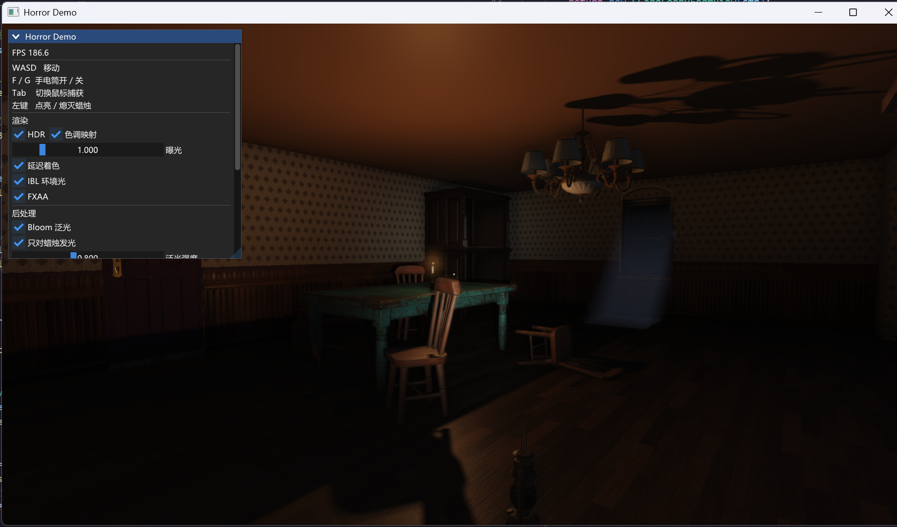
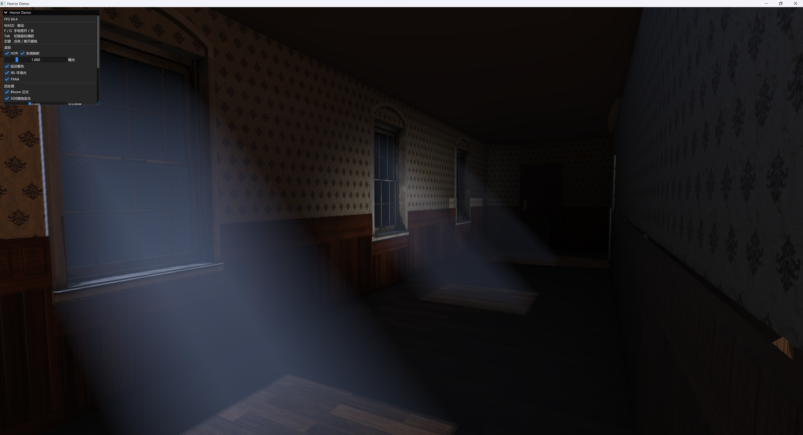

# Horror Demo

一个从零实现的实时渲染器，使用 C++ 与 OpenGL 3.3，不依赖任何图形引擎。
场景位于一间夜间的老宅：餐厅、走廊、洗手间，有月光、烛火、手电筒等光源及各式家具。

## 特性

**渲染管线**
- 延迟着色：G-buffer（albedo / 世界法线 / 世界坐标）+ 屏幕空间逐像素光照
- PBR（Cook-Torrance）+ IBL：辐照度卷积、GGX 预过滤、split-sum BRDF LUT，烘焙结果带磁盘缓存
- HDR（RGBA16F）+ ACES tone mapping + sRGB 编码

**光照与阴影**
- 点光 / 聚光 / 平行光三种类型
- 点光用 cubemap 六面深度图，聚光与平行光用 2D 深度图
- PCF 3×3 与 PCSS 软阴影

**后处理**
- 屏幕空间体积雾（光线步进 + 阴影图可见性 + Henyey-Greenstein 相函数）
- SSAO、Bloom、FXAA
- 平面反射（镜像相机 + 斜近裁剪面）

**其他**
- 程序化火焰、闪电、碰撞检测、蜡烛交互

## 构建

所有依赖随仓库携带，**不需要联网下载**。
由于 `glfw3.lib` 是 MSVC 编译的静态库，只能用 MSVC 工具链构建。

1. **VS 2022 → 文件 → 打开 → 文件夹**，选中项目根目录
2. VS 自动读取 `CMakeSettings.json`（Ninja + MSVC x64）
3. 顶部启动项选择 `Demo.exe`，按 **F5**

产物在 `out/build/x64-Debug/Demo.exe`，不需要手动执行任何 CMake 命令。

#### 环境要求

Visual Studio 2022 安装器里需要勾选：

| 项目 | 
|------|
| 使用 C++ 的桌面开发 |
| MSVC v143 - VS 2022 C++ x64/x86 生成工具 |
| Windows 10/11 SDK | 
| **适用于 Windows 的 C++ CMake 工具** | 
| Ninja | 

## 操作

| 按键 | 功能 |
|------|------|
| WASD | 移动 |
| 鼠标 | 转视角 |
| F / G | 手电筒开 / 关 |
| Tab | 释放鼠标 |
| E | 点亮 / 熄灭蜡烛 |

## 资产来源

模型与贴图来自 Poly Haven（CC0）、ambientCG（CC0）、Sketchfab 与 Fab（CC BY 4.0）。
作者、许可证与修改说明详见 [CREDITS.md](CREDITS.md)。

本项目仅用于学习交流，不用于商业用途。

## 目前缺陷

- 体积雾只处理平行光（月光），手电筒的光柱未实现
- 体积光在远处看会有噪点
- 未加入音频等系统
- 还未进行性能优化
- 目前仅在Windows + NVIDIA上测试过
