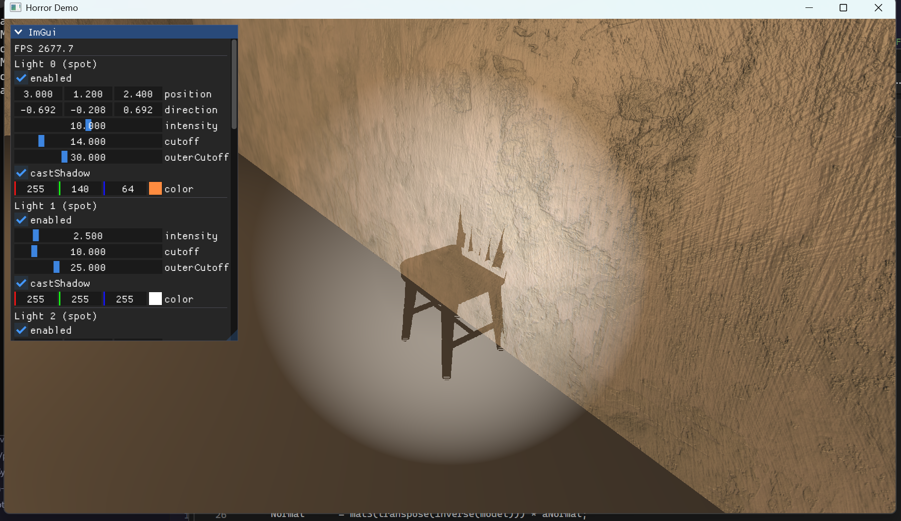
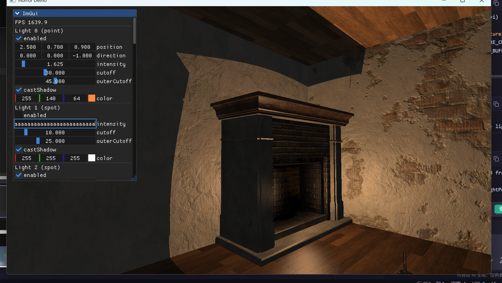

# 问题整理

- [阴影](#阴影)
- [点光源阴影漏光](#点光源阴影漏光)

## 阴影

- 问题：导入建模后阴影出现在奇怪的位置



- 原因分析：

  1. 主 Pass（`assets/shaders/horror.vert`）用 `model * vec4(aPos, 1.0)` 把顶点从模型空间变换到世界空间，模型的位移 / 旋转 / 缩放全靠这个 `model` 矩阵：

     ```glsl
     vec4 world4 = model * vec4(aPos, 1.0);
     WorldPos    = world4.xyz;
     gl_Position = projection * view * world4;
     ```

  2. 阴影 Pass（`assets/shaders/shadowdepth.vert`）里 **没有 `model`**，顶点保持模型空间原始坐标：

     ```glsl
     gl_Position = lightSpaceMatrix * vec4(aPos, 1.0);
     ```

  3. 根因在接口层：`CShadow::Render` 只接收 `std::vector<const CMesh*>`，而 `CMesh` 只持有 VAO / VBO / EBO，**不携带任何变换信息**。深度 Pass 即使想应用 model 也没有渠道。

  4. 结果：深度图里模型停留在原点、原始大小。

  5. 视觉表现：原点附近的地面 / 墙面出现模型的轮廓阴影，轮廓和实体一致、边缘硬，看起来就像场景里**凭空多了一把椅子**。

  6. 为什么之前只有盒子时没暴露：`AppendBoxMesh` 生成的顶点**本身就是世界坐标**，Group 的 model 是单位矩阵，两条路径恰好一致，问题被掩盖了。

- 解决方案：

  1. `assets/shaders/shadowdepth.vert` 增加 model uniform：

     ```glsl
     uniform mat4 lightSpaceMatrix;
     uniform mat4 model;

     void main()
     {
         gl_Position = lightSpaceMatrix * model * vec4(aPos, 1.0);
     }
     ```

  2. `CShadow` 改为按「mesh + model」成对绘制：

     ```cpp
     struct DrawItem
     {
         const CMesh* mesh  = nullptr;
         glm::mat4    model{ 1.0f };
     };

     void Render(const std::vector<DrawItem>& items, ...);
     ```

     绘制循环里逐个设置 model：

     ```cpp
     for (const DrawItem& it : items)
     {
         if (!it.mesh) continue;
         m_depthShader.setMat4("model", it.model);
         it.mesh->Draw();
     }
     ```

  3. `CScene::Render` 构造 items 时带上每个 Group 的变换：

     ```cpp
     items.push_back({
         g->mesh.get(),
         ComposeTransform(g->modelPos, g->modelRotDeg, g->modelScale)
     });
     ```

  4. 验证：改完后「第二把椅子」消失，桌椅的阴影落在正确位置。

- 经验总结：

  - **多 Pass 渲染时，所有 Pass 必须共用同一套变换**。主 Pass 用了哪些矩阵，阴影 Pass 一个都不能少，否则几何位置直接错位。
  - 接口设计上，只传 mesh 不传 model 就是埋坑。`CMesh` 是纯 GPU 资源封装，本来就不该知道变换；变换应该由调用方显式传进来。

## 点光源阴影漏光

- 问题：壁炉改成点光源（cubemap 阴影）后，投在墙上的影子里出现斜向条纹，边缘有缺口，像「漏缝」。影子整体轮廓是对的，但内部被切成一条条。



- 原因分析：

  1. **剔正面导致薄壁漏光（主因）**。`CShadowCube::Render` 一开始沿用了聚光灯的写法：

     ```cpp
     glEnable(GL_CULL_FACE);
     glCullFace(GL_FRONT);
     ```

     这个技巧只适用于**闭合实体**（正反面互相接得上，剔掉正面仍有背面写深度）。但壁炉模型的 gltf 里是 `"doubleSided": true`，存在大量单层面片（木板、装饰线条）。剔掉正面之后，这些位置在深度图里**没有任何深度写入**，相当于“这里没有遮挡物”，光直接漏过去，影子就出现缺口和条纹。

  2. **bias 是归一化值，实际有 1 米**。主 Pass 的比较发生在 `[0,1]` 的归一化空间：

     ```glsl
     float current = length(dir) / farPlane;
     float closest = texture(cube, dir).r;
     return current - bias > closest ? 1.0 : 0.0;
     ```

     `bias = 0.035`，`farPlane = 30`，所以实际容忍了 `0.035 × 30 = 1.05 米` 的深度差。壁炉上的装饰凸起投到墙上的细影子厚度不足 1 米，被 bias 直接吃掉。

  3. **分辨率不足**。cubemap 只有 512²，单面覆盖 90° FOV。壁炉在 3 米外时，一个 texel 对应约 `3 × tan(45°) / 256 ≈ 1.2 cm`，墙上的影子边缘就是这个精度的阶梯。

- 解决方案：

  1. 点光阴影**关闭剔除**（薄壁模型不能剔正面）：

     ```cpp
     // 点光阴影不能剔正面：壁炉这类模型是双面材质、几何有薄片
     // 剔掉正面后薄片处没有深度写入，光就漏过去了（影子出现缺口）
     glDisable(GL_CULL_FACE);
     ```

  2. bias 从 `0.035` 降到 `0.015`（1.05 m → 0.45 m），并把换算关系写进注释：

     ```glsl
     // 注意这里是「归一化到 farPlane 的距离」，0.015 * 30m = 0.45m
     float bias = 0.015;
     ```

  3. cubemap 从 512 提到 1024，同时改成**按需创建**，避免每盏点光都占 24 MB：

     ```cpp
     // 点光 cube 在 Render 里按需创建：6 面 × 1024² 很占显存，
     // 不是每盏点光都投影，没必要一次全建出来
     m_cubePasses.resize(count);
     ```

     ```cpp
     // 首次用到这盏点光时才分配 cubemap
     if (!m_cubePasses[i])
         m_cubePasses[i] = std::make_unique<CShadowCube>(1024);
     ```

- 经验总结：

  - **`glCullFace(GL_FRONT)` 是闭合实体的专用技巧**。用之前先确认模型是否 `doubleSided`、有没有薄片；B 站和教程里直接照抄很容易在导入模型后才踩到。
  - **归一化空间的 bias 必须换算成实际距离**：`bias_world = bias × farPlane`。写 `0.035` 时脑子里要想的是「1 米」，而不是「3.5%」。
  - **阴影分辨率按「最远距离 ÷ 面数」估算精度**：`1024` 面、`farPlane = 30` 时，30 米处一个 texel 约 3 cm。要看清 1 cm 的结构就得提高分辨率或缩短 farPlane。
  - 点光阴影真正的成本是 6 次全场绘制，所以只在「必须全方向投影」的灯上开，其余用聚光或干脆不投影。